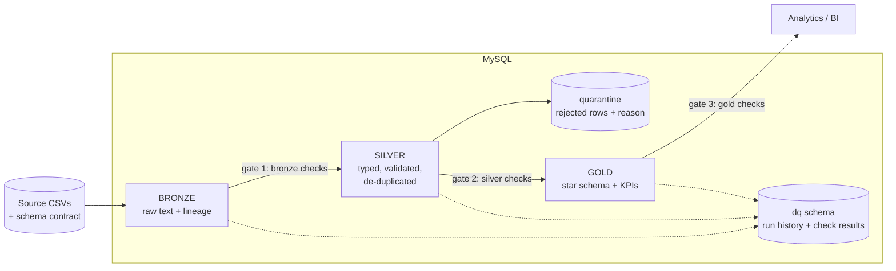
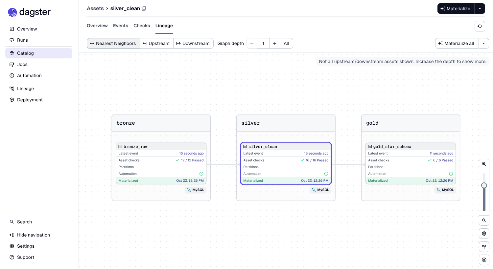
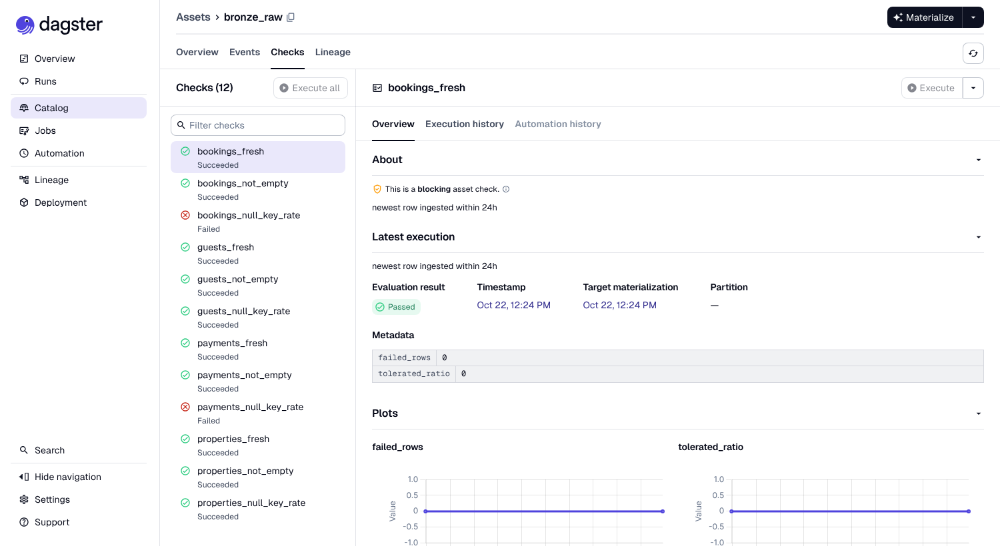

# MySQL Medallion Data-Quality Pipeline

[](https://github.com/Gri-byte/mysql-medallion-dq-pipeline/actions/workflows/ci.yml)

A small but complete data-engineering project on **MySQL 8**: hotel booking data flows through a
**Medallion architecture** (bronze → silver → gold), with **data-quality gates between every layer**,
a **quarantine** for rejected rows, a **star schema** for analytics, and a test suite that proves the
pipeline fails safely.

> **The idea that drives the project:** a pipeline that only works on clean data is not reliable.
> The generator injects *known* defects on purpose, and the tests check that the pipeline caught
> **exactly** those rows — no more, no fewer — and that bad batches never reach gold.

## Architecture



| Layer | Database | What it guarantees |
|---|---|---|
| **Bronze** | `hotel_bronze` | Raw data exactly as received (all text) + lineage (`_batch_id`, `_source_file`, `_ingested_at`). Nothing is rejected here, so bad data stays visible. |
| **Silver** | `hotel_silver` | Typed, trimmed, consistently cased, de-duplicated. Integrity enforced **by the engine** (PK / FK / CHECK). Rejected rows go to `quarantine` with a reason and the raw record. |
| **Gold** | `hotel_gold` | Star schema (`dim_property`, `dim_guest`, `dim_date`, `fact_bookings`) and a monthly KPI table (revenue, ADR, cancellation rate). Rebuilt only if silver passed its gate. |
| **DQ** | `hotel_dq` | `pipeline_runs` and `check_results`: quality is recorded run after run, not just printed in a log. |

## Data-quality controls

| Control | Where | Behaviour |
|---|---|---|
| **Schema contract** | ingestion | A file with missing / extra columns is refused *before* any table is touched. |
| **Idempotent loads** | ingestion | Re-ingesting a file replaces that file's rows; re-running the pipeline changes nothing. |
| **Quarantine** | silver | One reject reason per row, raw record kept for diagnosis (see catalogue below). |
| **De-duplication** | silver | Latest ingested row per business key wins. |
| **Standardization** | silver | `' COMPLETED '`, `usd`, `ANA@X.COM` are cleaned, not rejected. |
| **Reconciliation** | silver / gold | `bronze = silver + quarantine + duplicates` for every table; gold revenue must equal revenue recomputed from silver. |
| **Volume-anomaly gate** | silver | If more than 10 % of a table is quarantined, the batch is stopped (`MAX_QUARANTINE_RATE`). |
| **Engine-level guards** | silver | PK, FK and CHECK constraints: a bug in the transformation cannot write an impossible row. |
| **Severity levels** | all | `ERROR` blocks the pipeline, `WARN` is recorded but does not. |
| **Blast-radius control** | pipeline | A failed gate stops the run; **gold keeps the last good data**. |

### Reject-reason catalogue

| Table | Reasons |
|---|---|
| `bookings` | `MISSING_KEY`, `INVALID_DATE`, `CHECKOUT_BEFORE_CHECKIN`, `INVALID_RATE`, `INVALID_CURRENCY`, `INVALID_STATUS`, `ORPHAN_PROPERTY`, `ORPHAN_GUEST` |
| `guests` | `MISSING_KEY`, `MISSING_NAME`, `INVALID_EMAIL`, `INVALID_COUNTRY` |
| `payments` | `MISSING_KEY`, `INVALID_AMOUNT`, `INVALID_CURRENCY`, `INVALID_DATE`, `INVALID_METHOD`, `ORPHAN_BOOKING`, `CURRENCY_MISMATCH` |
| `properties` | `MISSING_KEY`, `MISSING_NAME`, `INVALID_STARS`, `INVALID_ROOMS` |

Orphan checks run against **silver**, so a booking that belongs to a quarantined guest is quarantined
too instead of silently becoming an orphan.

## Example run

Default run: 8,000 bookings, 2,000 guests, 4 % injected defects.

```
bronze rows : {'properties': 12, 'guests': 2080, 'bookings': 8040, 'payments': 13773}
silver rows : {'properties': 12, 'guests': 1920, 'bookings': 7680, 'payments': 13119, 'quarantine': 945}
gold rows   : {'dim_property': 12, 'dim_guest': 1920, 'dim_date': 926, 'fact_bookings': 7680, 'agg_monthly_property_kpis': 360}
quarantine bookings : CHECKOUT_BEFORE_CHECKIN 40, INVALID_CURRENCY 40, INVALID_DATE 40, INVALID_RATE 40,
                      INVALID_STATUS 40, MISSING_KEY 40, ORPHAN_GUEST 40, ORPHAN_PROPERTY 40
checks      : 34/34 passed   (12 bronze, 16 silver, 6 gold)
```

The bronze row counts are higher than the silver ones because the files contain duplicates
(80 guests, 40 bookings, 109 payments) that silver collapses to one row each.

## Quick start

Requirements: Python 3.10+, and a MySQL 8 server you can create databases on
(a local install), or just Docker (see below).

```bash
git clone https://github.com/Gri-byte/mysql-medallion-dq-pipeline.git
cd mysql-medallion-dq-pipeline

python -m venv .venv
source .venv/bin/activate          # Windows: .venv\Scripts\activate
pip install -r requirements.txt

cp .env.example .env               # Windows: copy .env.example .env  -> then edit MYSQL_PASSWORD
python -m src.run_pipeline --reset
```

Then open **DBeaver** (or any client), refresh the connection and you will see four databases:
`hotel_bronze`, `hotel_silver`, `hotel_gold`, `hotel_dq`. Open
[`sql/analytics_queries.sql`](sql/analytics_queries.sql) and run the queries.

```bash
python -m src.run_pipeline --bookings 20000 --defect-rate 0.08   # bigger / dirtier data
python -m src.run_pipeline --defect-rate 0.30                    # watch a quality gate stop the run (exit code 2)
python -m src.run_pipeline --no-generate --data-dir ./my_csvs    # your own files (must match src/contracts.py)
```

> `cryptography` is in `requirements.txt` because MySQL 8's default authentication
> (`caching_sha2_password`) needs it with PyMySQL.

### Or run everything with Docker (no Python or MySQL install needed)

```bash
docker compose up --build                        # MySQL + pipeline, runs once and exits
docker compose run --rm pipeline pytest -v       # the test suite, inside the container
docker compose down -v                           # stop and delete the database volume
```

- The password is read from `MYSQL_PASSWORD` (shell or `.env`); the default is `local_password`.
- MySQL is published on **host port 3307**, not 3306, so it never collides with a MySQL already installed
  on your machine. Connect DBeaver to `127.0.0.1:3307`, user `root`. Change it with `MYSQL_HOST_PORT`.
- The pipeline container waits for MySQL's health check before starting, and runs as a non-root user.
- Generated CSVs appear in `./data/raw` on your machine.

## Orchestration with Dagster (optional)

The CLI runs the pipeline once. [Dagster](https://dagster.io) adds what a real deployment needs on top:
a schedule, run history, retries-on-demand and a UI where every quality check is visible. The business
logic is **not** duplicated: the Dagster assets call the same functions the CLI uses.



| In the CLI | In Dagster |
|---|---|
| source, bronze, silver, gold stages | 4 **assets** with lineage (`source_csv_files -> bronze_raw -> silver_clean -> gold_star_schema`) |
| 34 quality checks | 34 **blocking asset checks** (12 bronze, 16 silver, 6 gold), each with its description and failed-row metadata |
| `ERROR` stops the run, `WARN` is reported | a failed `ERROR` check turns red and **downstream assets do not run**; a `WARN` is shown but blocks nothing |
| `pipeline_runs` / `check_results` tables | the same tables, keyed by the Dagster run id, so the SQL views keep working |
| run it by hand | **daily schedule at 06:00 (America/Argentina/Buenos_Aires)** while the Dagster daemon is running |



Run it locally (from the project root, with `requirements.txt` already installed):

```bash
pip install -r requirements-orchestration.txt
mkdir .dagster_home
export DAGSTER_HOME="$PWD/.dagster_home"     # Windows (cmd): set DAGSTER_HOME=%CD%\.dagster_home
dagster dev -w workspace.yaml
```

Open <http://localhost:3000>, go to **Lineage** and press **Materialize all**. `DAGSTER_HOME` keeps the run
history between restarts; without it Dagster uses a temporary folder.

**Watch a gate stop the run:** open the Launchpad from the dropdown next to *Materialize all* and set

```yaml
ops:
  source_csv_files:
    config:
      defect_rate: 0.30
```

Bronze's null-key checks fail, silver and gold are skipped, the run is marked failed in both Dagster and
`hotel_dq.pipeline_runs`, and `hotel_gold` keeps serving the last good data.

With Docker: `docker compose --profile dagster up --build dagster`, then open <http://localhost:3000>.
The UI is published on localhost only, because it has no authentication.

## Tests

```bash
pytest -v
```

56 tests with Dagster installed, 46 without (the Dagster suite skips itself when `dagster` is missing).
The tests run against a **real MySQL server** (not mocks) in databases prefixed `test_hotel_…`,
and drop them afterwards. Your `hotel_*` databases are never touched.

| Suite | What it proves |
|---|---|
| `test_generator.py` | The data generator is deterministic and its defect manifest adds up (no DB needed). |
| `test_pipeline_e2e.py` | Silver row counts and quarantine reasons match the **injected ground truth**; nothing is silently lost; dirt is standardized; gold reconciles with silver; revenue is never mixed across currencies; re-running is idempotent; every analytics query returns rows. |
| `test_dagster.py` | A full Dagster run materializes every asset and passes all 34 checks; silver matches the injected ground truth; a failed `ERROR` check blocks downstream assets and is recorded; a failed run never overwrites the last good gold; `WARN` failures do not block; asset checks map one-to-one to `checks.py`; the daily schedule is defined. |
| `test_failure_modes.py` | Excess defects stop the pipeline at the right layer; a failed batch does **not** overwrite last good gold; schema drift and empty files are refused; the engine rejects bad rows even if the pipeline had a bug; the DQ engine's tolerance and severity rules behave as documented. |

CI ([`.github/workflows/ci.yml`](.github/workflows/ci.yml)) runs lint, validates the Dagster definitions,
runs the full suite and a demo run against a `mysql:8.0` service container on every push and pull request.

## Project layout

```
sql/        00-04  DDL per layer        10_silver_load.sql   20_gold_load.sql   analytics_queries.sql
src/        contracts.py  config.py  db.py  generate_data.py  ingest_bronze.py
            transform_silver.py  build_gold.py  checks.py  dq.py  run_pipeline.py
orchestration/  resources.py  assets.py  definitions.py   (Dagster: assets, checks, job, schedule)
tests/      generator, end-to-end, failure-mode and Dagster suites
docs/       screenshots used in this README
.github/    CI workflow + Dependabot
Dockerfile  docker-compose.yml  (MySQL 8 + pipeline + optional Dagster)
workspace.yaml  requirements-orchestration.txt
```

The transformations are **plain SQL files** (the logic a data engineer reviews), executed by thin
Python orchestration. Python handles files, run bookkeeping and the DQ engine.

## Design decisions and trade-offs

- **Full refresh, not incremental.** Silver and gold are rebuilt on every run, which makes the pipeline
  idempotent and easy to reason about. For tables in the hundreds of millions of rows you would move to
  incremental loads keyed on `_ingested_at` — a natural next step.
- **Validation is explicit, not left to the engine.** Casting bad text in a lenient session can silently
  produce `0000-00-00`; in strict mode it aborts the whole batch. Instead, rules are written in SQL
  (regex, ranges, joins) so each bad row gets a *reason*. Silver's CHECK constraints stay on as a
  second line of defence.
- **Calendar validity is checked by hand.** Engines disagree on impossible dates: MySQL 8 turns
  `'2025-02-30'` into `NULL`, MariaDB keeps it as-is. The pipeline validates
  `DAYOFMONTH(d) <= DAY(LAST_DAY(d))` explicitly so behaviour does not depend on the engine.
  (Found while developing on MariaDB 10.11; see the comment at the top of `10_silver_load.sql`.)
- **A failed gate leaves the bad batch in bronze / silver / quarantine for diagnosis**, but never builds
  gold from it. Dashboards keep serving the last good data.
- **Currencies are never summed together** (USD / ARS / EUR) because no FX rates are assumed. The KPI
  grain includes `currency`.
- **KPIs are attributed to the month of check-in.** Stays that cross a month boundary are not split, so
  no occupancy rate is published (it would be misleading); `room_nights_sold` and `ADR` are.
- **Dagster wraps the logic, it does not replace it.** The SQL and the check catalogue stay in `src/`;
  the CLI and the Dagster assets call the same functions, and a test asserts that the 34 asset checks
  match `checks.py` one-to-one, so the two entry points cannot drift apart.
- **Blocking asset checks instead of exceptions.** In Dagster a failed `ERROR` check keeps the layer's data
  in MySQL for diagnosis but stops the next asset, which is the same contract as the CLI gate.
- **No secrets in Dagster's configuration.** Credentials come from the environment / `.env` exactly as in
  the CLI; only non-secret knobs (database prefix, quarantine threshold) are configurable resources.
- **The schedule only fires while the Dagster daemon is running.** `dagster dev` includes it, so a laptop
  that is off skips the run. `dagster dev` is a development server: a production deployment would run the
  webserver and the daemon as separate services with Postgres as run storage.
- **The Dagster source asset is synthetic.** It stands in for files landing from an upstream system;
  everything downstream of it would stay the same behind a real source.
- **Synthetic data.** The data is generated (fixed seed, fixed "today" of 2026-07-01) so the project is
  reproducible and contains no personal information.

## Possible extensions

- Move the SQL transformations to dbt models + tests and run them as Dagster assets.
- Replace the synthetic source asset with a Dagster sensor that reacts to real files arriving.
- Incremental silver / gold loads and Slowly Changing Dimensions (type 2) for `dim_property`.
- Expose `dq.check_results` in a dashboard (failed checks over time, quarantine rate by reason).
- Add a Great Expectations suite or contract tests for the source files.
